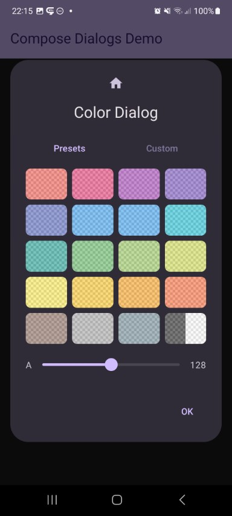
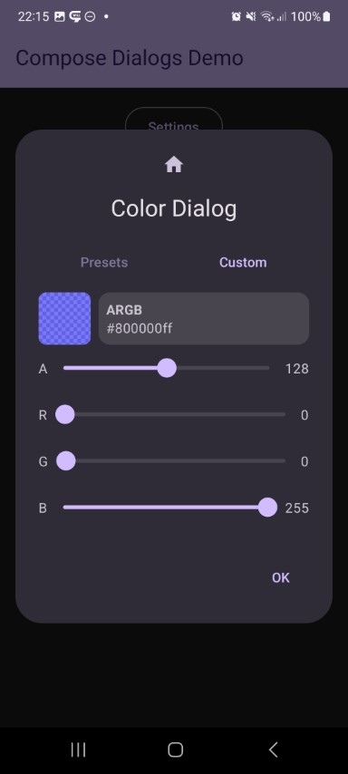
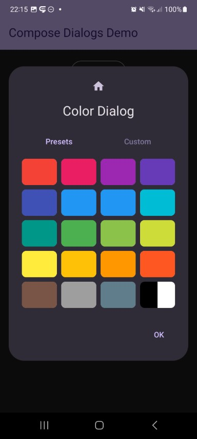
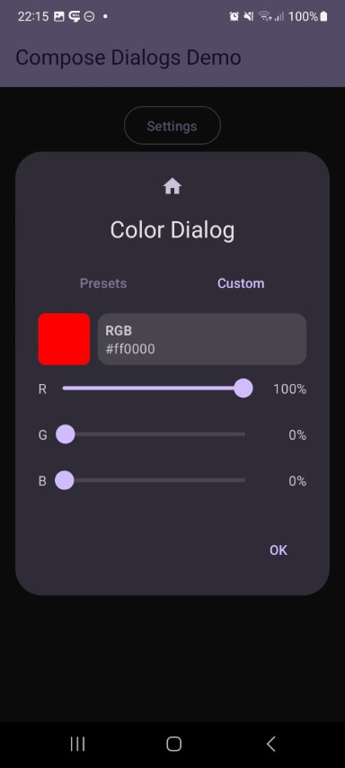

This shows a color selector dialog. A table with predefined material colors as well as a customisation page will be shown. Alpha support can be enabled optionally.

Check out the composable and it's documentation in the code snipplet below.

Generally following can be adjusted:

* alpha support yes/no
* shape of a color composable inside the color grid (rect, rounded rect, circle, ...)
* the number of columns in the color grid
* the style of how RGB(A) values are displayed (either as a number in the range of [0, 255] or as a percentage value [0%, 100%])

#### Example

<!-- snippet: ColorDemos::demo -->
```kt
if (state.visible) {
    val color = rememberColorPickerColor(Color.Blue.copy(alpha = .5f))
    DialogColor(
        state = state,
        color = color,
        config = ColorPickerDefaults.config(alphaSupported = true),
        icon = icon,
        title = { Text("Color Dialog") },
        style = style,
        onEvent = {
            if (it is DialogEvent.Button && it.button == DialogButtonType.Positive) {
                val hex = color.value.toArgb().toUInt().toString(16).padStart(8, '0')
                showInfo("Selected color: #$hex")
            } else {
                showInfo("Event $it")
            }
        }
    )
}
```
<!-- endSnippet -->

#### Composable

<!-- snippet: DialogColor::constructor -->
```kt
/**
 * Shows a color dialog
 *
 * &nbsp;
 *
 * **Basic Parameters:** all params not described here are derived from [Dialog], check it out for more details
 *
 * @param color the selected color state
 * @param config the color picker's behavior and appearance
 * @param texts the texts ([ColorPickerTexts]) that are used inside this dialog - use [ColorPickerDefaults.texts] to provide your own data
 */
@Composable
fun DialogColor(
    // Base Dialog - State
    state: BaseDialogState,
    // Custom - Required
    color: MutableState<Color>,
    // Custom - Optional
    config: ColorPickerConfig = ColorPickerDefaults.config(
        shape = MaterialTheme.shapes.small,
        gridSize = if (isLandscape()) 6 else 4
    ),
    texts: ColorPickerTexts = ColorPickerDefaults.texts(),
    // Base Dialog - Optional
    title: (@Composable () -> Unit)? = null,
    icon: (@Composable () -> Unit)? = null,
    style: ComposeDialogStyle = DialogDefaults.defaultDialogStyle(),
    buttons: DialogButtons = DialogDefaults.buttons(),
    options: DialogOptions = DialogDefaults.options(),
    onEvent: (event: DialogEvent) -> Unit = {}
)
```
<!-- endSnippet -->

#### Screenshots

|                                                     | | | |
|-----------------------------------------------------|-|-|-|
|  |  |  |  |
