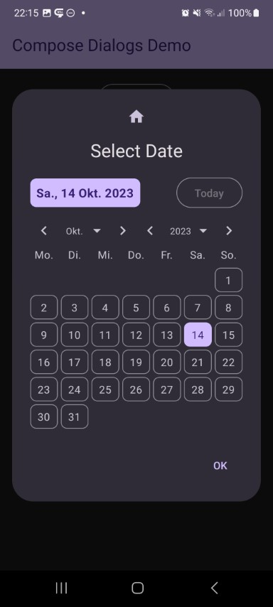
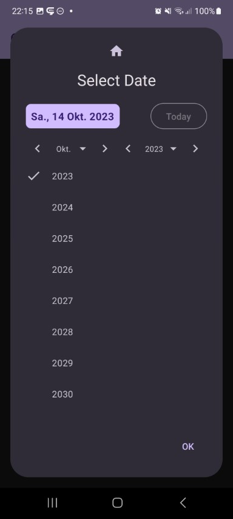

This shows a date selector dialog. First day of week, labels, and style can be adjusted to your needs.

Check out the composable and it's documentation in the code snipplet below.

Generally following can be adjusted:

* custom texts
* custom first day of week
* cel height of the calendar
* optional next/previous month buttons

#### Example

<!-- snippet: Demos::demo-date -->
```kt
if (state.visible) {

    // special state for date dialog
    val date = rememberDialogDate()
    // optional settings
    var setup = DialogDateDefaults.setup(
        dateCellHeight = 32.dp
    )
    if (customSetup) {
        setup = DialogDateDefaults.setup(
            buttonToday = {
                Icon(Icons.Default.Today, null)
            },
            firstDayOfWeek = DayOfWeek.SUNDAY,
            dateCellHeight = 32.dp,
            showNextPreviousMonthButtons = false,
            showNextPreviousYearButtons = false,
            // formats are just defined as they are already by default, but you
            // see how you could simply change them...
            formatterWeekDayLabel = { defaultFormatterWeekDayLabel(it) },
            formatterSelectedDate = {
                defaultFormatterSelectedDate(it)
            },
            formatterSelectedMonth = {
                defaultFormatterSelectedMonth(it)
            },
            formatterSelectedYear = { it.toString() },
            formatterMonthSelectorList = {
                defaultFormatterSelectedMonthInSelectorList(it)
            },
            formatterYearSelectorList = { it.toString() }
        )
    }
    val dateRange = DialogDateDefaults.dateRange()

    DialogDate(
        state = state,
        date = date,
        setup = setup,
        dateRange = dateRange,
        icon = icon,
        title = { Text("Select Date") },
        style = style,
        onEvent = {
            if (it is DialogEvent.Button && it.button == DialogButtonType.Positive) {
                showInfo("Selected Date: ${date.value}")
            } else {
                showInfo("Event $it")
            }
        }
    )
}
```
<!-- endSnippet -->

#### Composable

<!-- snippet: DialogDate::constructor -->
```kt
/**
 * Shows a dialog with an input field
 *
 * &nbsp;
 *
 * **Basic Parameters:** all params not described here are derived from [Dialog], check it out for more details
 *
 * @param date the selected date state
 * @param dateRange the supported [DialogDateDefaults.Range] - use [DialogDateDefaults.dateRange] to provide your own data
 * @param setup the [DialogDateDefaults.Setup] - use [DialogDateDefaults.setup] to provide your own data
 */
@OptIn(ExperimentalComposeUiApi::class)
@Composable
fun DialogDate(
    state: BaseDialogState,
    date: MutableState<LocalDate>,
    dateRange: DialogDateDefaults.Range = DialogDateDefaults.dateRange(),
    setup: DialogDateDefaults.Setup = DialogDateDefaults.setup(),
    title: (@Composable () -> Unit)? = null,
    icon: (@Composable () -> Unit)? = null,
    style: ComposeDialogStyle = DialogDefaults.defaultDialogStyle(),
    buttons: DialogButtons = DialogDefaults.buttons(),
    options: DialogOptions = DialogDefaults.options(),
    onEvent: (event: DialogEvent) -> Unit = {}
) {
    val landscape = isLandscape()
    Dialog(
        state,
        title?.takeIf { !landscape },
        icon?.takeIf { !landscape },
        style,
        buttons,
        options,
        onEvent = onEvent
    ) {
        DatePicker(
            uiProvider = Material3DateUIProvider,
            date = date,
            dateRange = DatePickerRange(dateRange.years),
            setup = DatePickerSetup(
                setup.buttonToday,
                setup.firstDayOfWeek,
                setup.formatterWeekDayLabel,
                setup.formatterSelectedDate,
                setup.formatterSelectedMonth,
                setup.formatterSelectedYear,
                setup.formatterMonthSelectorList,
                setup.formatterYearSelectorList,
                setup.dateCellHeight,
                setup.showNextPreviousMonthButtons,
                setup.showNextPreviousYearButtons
            ),
            landscape = landscape,
            title = title,
            icon = icon
        )
    }
}
```
<!-- endSnippet -->

#### Screenshots

| | |                                                       |
|-|-|-------------------------------------------------------|
|  |  |  |
