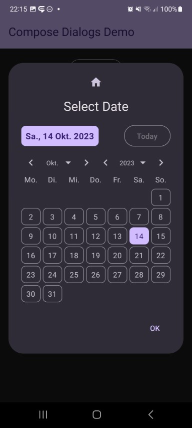
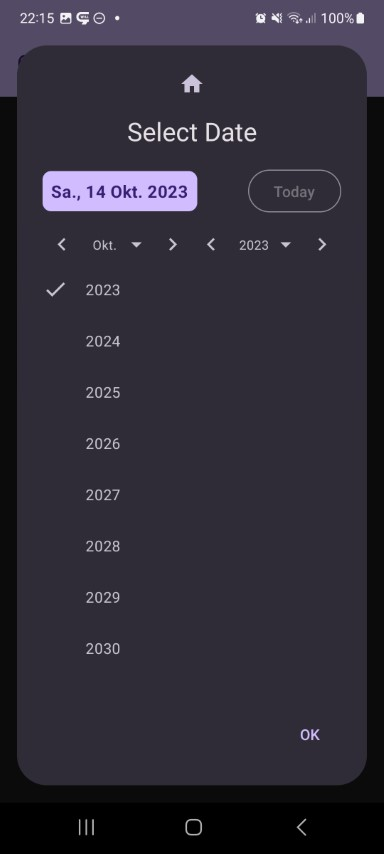

This shows a date selector dialog. First day of week, labels, and style can be adjusted to your needs.

Check out the composable and it's documentation in the code snipplet below.

Generally following can be adjusted:

* custom texts
* custom first day of week
* cel height of the calendar
* optional next/previous month buttons

On Android API 24-25, enable core library desugaring in the consuming app module:

```kotlin
android {
    compileOptions {
        isCoreLibraryDesugaringEnabled = true
    }
}

dependencies {
    coreLibraryDesugaring("com.android.tools:desugar_jdk_libs:2.1.5")
}
```

#### Example

<!-- snippet: Demos::demo-date -->
```kt
if (state.visible) {

    // special state for date dialog
    val date = rememberDatePickerDate()
    val buttonToday: (@Composable () -> Unit)? = if (customSetup) {
        { Icon(Icons.Default.Today, null) }
    } else {
        { BasicText(text = DatePickerDefaults.texts().today) }
    }
    // optional settings
    var config = DatePickerDefaults.config(
        dateCellHeight = 32.dp
    )
    if (customSetup) {
        config = DatePickerDefaults.config(
            firstDayOfWeek = DayOfWeek.SUNDAY,
            dateCellHeight = 32.dp,
            showNextPreviousMonthButtons = false,
            showNextPreviousYearButtons = false,
            // formats are just defined as they are already by default, but you
            // see how you could simply change them...
            formatterWeekDayLabel = { defaultFormatterWeekDayLabel(it) },
            formatterSelectedDate = {
                defaultFormatterSelectedDate(it)
            },
            formatterSelectedMonth = {
                defaultFormatterSelectedMonth(it)
            },
            formatterSelectedYear = { it.toString() },
            formatterMonthSelectorList = {
                defaultFormatterSelectedMonthInSelectorList(it)
            },
            formatterYearSelectorList = { it.toString() }
        )
    }

    DialogDate(
        state = state,
        date = date,
        config = config,
        buttonToday = buttonToday,
        icon = icon,
        title = { Text("Select Date") },
        style = style,
        onEvent = {
            if (it is DialogEvent.Button && it.button == DialogButtonType.Positive) {
                showInfo("Selected Date: ${date.value}")
            } else {
                showInfo("Event $it")
            }
        }
    )
}
```
<!-- endSnippet -->

#### Composable

<!-- snippet: DialogDate::constructor -->
```kt
/**
 * Shows a dialog with a date picker.
 *
 * &nbsp;
 *
 * **Basic Parameters:** all params not described here are derived from [Dialog], check it out for more details
 *
 * @param date the selected date state
 * @param config the date picker's formatting, behavior, and supported year range
 * @param buttonToday optional content for the Today button; pass null to hide it
 */
@Composable
fun DialogDate(
    state: BaseDialogState,
    date: MutableState<LocalDate>,
    config: DatePickerConfig = DatePickerDefaults.config(),
    buttonToday: (@Composable () -> Unit)? = {
        BasicText(text = DatePickerDefaults.texts().today)
    },
    title: (@Composable () -> Unit)? = null,
    icon: (@Composable () -> Unit)? = null,
    style: ComposeDialogStyle = DialogDefaults.defaultDialogStyle(),
    buttons: DialogButtons = DialogDefaults.buttons(),
    options: DialogOptions = DialogDefaults.options(),
    onEvent: (event: DialogEvent) -> Unit = {},
)
```
<!-- endSnippet -->

#### Screenshots

| | |                                                       |
|-|-|-------------------------------------------------------|
|  |  |  |
