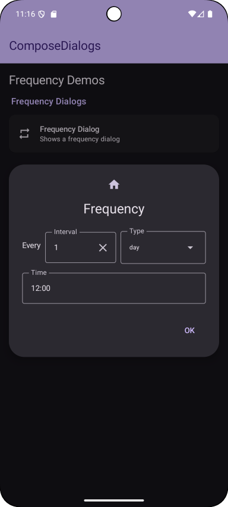
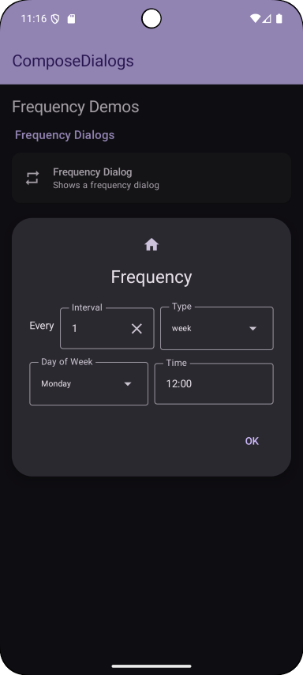
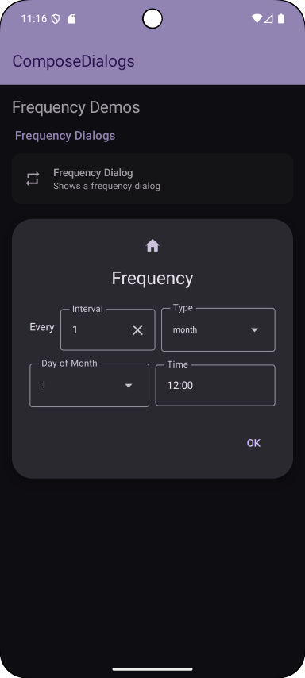
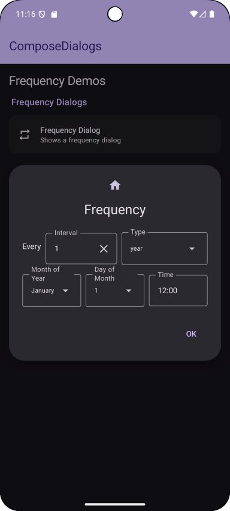

This shows a frequency selector dialog. It supports daily, weekly, monthly and yearly frequencies.

Check out the composable and it's documentation in the code snipplet below.

#### Example

<!-- snippet: Demos::demo-frequency -->
```kt
if (state.visible) {
    val frequency =
        rememberFrequency(Frequency.Weekly(DayOfWeek.MONDAY, LocalTime(12, 0), 1))
    DialogFrequency(
        state = state,
        frequency = frequency,
        title = { Text("Frequency") },
        icon = icon,
        style = style,
        onEvent = { event ->
            showInfo("Event $event | frequency: ${frequency.value}")
        }
    )
}
```
<!-- endSnippet -->

#### Composable

<!-- snippet: DialogFrequency::constructor -->
```kt
/**
 * Shows a frequency dialog
 *
 * &nbsp;
 *
 * **Basic Parameters:** all params not described here are derived from [Dialog], check it out for more details
 *
 * @param frequency the frequency state of the dialog - use [com.michaelflisar.composedialogs.dialogs.frequency.classes.rememberFrequency] to create a state for this parameter
 * @param config the frequency picker's behavior and embedded time picker configuration
 * @param texts the texts ([FrequencyPickerTexts]) that are used inside this dialog - use [FrequencyPickerDefaults.texts] to provide your own data
 */
@Composable
fun DialogFrequency(
    state: BaseDialogState,
    // Custom - Required
    frequency: MutableState<Frequency>,
    // Custom - Optional
    config: FrequencyPickerConfig = FrequencyPickerDefaults.config(),
    texts: FrequencyPickerTexts = FrequencyPickerDefaults.texts(),
    // Base Dialog - Optional
    title: (@Composable () -> Unit)? = null,
    icon: (@Composable () -> Unit)? = null,
    style: ComposeDialogStyle = DialogDefaults.defaultDialogStyle(),
    buttons: DialogButtons = DialogDefaults.buttons(),
    options: DialogOptions = DialogDefaults.options(),
    onEvent: (event: DialogEvent) -> Unit = {},
)
```
<!-- endSnippet -->

#### Frequency class

The frequency API can calculate the next occurrence after a local date and time. Calling
`calcNextOccurrence()` without an argument calculates it after the current time, using the supplied
time zone (or the system time zone by default).

<!-- snippet: Frequency::calcNextOccurrence -->
```kt
/**
 * Calculates the first occurrence strictly after [after], based on the frequency settings.
 *
 * @param after The local date and time after which to calculate the next occurrence.
 * @param timeZone The time zone to consider for the calculation (defaults to the system's current time zone).
 * @return The next occurrence as a LocalDateTime.
 */
abstract fun calcNextOccurrence(
    after: LocalDateTime,
    timeZone: TimeZone = TimeZone.currentSystemDefault(),
): LocalDateTime
```
<!-- endSnippet -->

<!-- snippet: Frequency::duration -->
```kt
/**
 * Calendar period between occurrences. Month and year periods depend on the date they are applied to.
 *
 * For month-end and leap-day frequencies, use [calcNextOccurrence] to build a sequence so the
 * selected day is preserved when a month or year is shorter.
 */
abstract val duration: DateTimePeriod
```
<!-- endSnippet -->

Here's a small example:

```kotlin
val time = LocalTime(12, 0)
val frequencyDaily1 = Frequency.Daily(time, 1)
val frequencyWeekly1 = Frequency.Weekly(DayOfWeek.MONDAY, time, 1)
val frequencyMonthly1 = Frequency.Monthly(31, time, 1)
val frequencyYearly1 = Frequency.Yearly(Month.JANUARY, 31, time, 1)

// Friday, January 31, 2025, after the scheduled time
val after = LocalDateTime(2025, Month.JANUARY, 31, 12, 1)

val nextDaily1 = frequencyDaily1.calcNextOccurrence(after) // February 1, 2025
val nextWeekly1 = frequencyWeekly1.calcNextOccurrence(after) // February 3, 2025
val nextMonthly1 = frequencyMonthly1.calcNextOccurrence(after) // February 28, 2025
val nextYearly1 = frequencyYearly1.calcNextOccurrence(after) // January 31, 2026
val dailyDuration = frequencyDaily1.duration // DateTimePeriod(days = 1)

// Build a sequence while preserving the selected day for month-end and leap-day frequencies.
val next3Monthly1 = buildList {
    var occurrence = after
    repeat(3) {
        occurrence = frequencyMonthly1.calcNextOccurrence(occurrence)
        add(occurrence)
    }
}
```

#### Screenshots

|                                                             |                                                        |                                                             |                                                             |
|-------------------------------------------------------------|--------------------------------------------------------|-------------------------------------------------------------|-------------------------------------------------------------|
|  |  |  |  |
