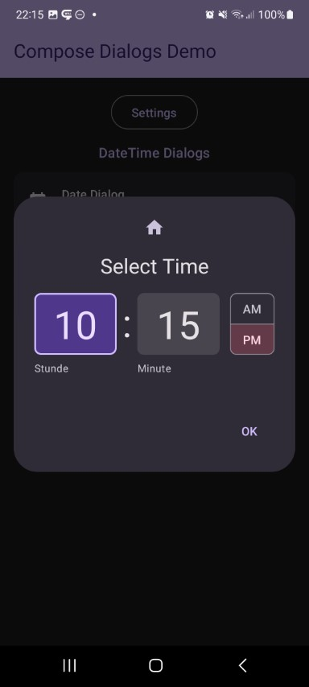
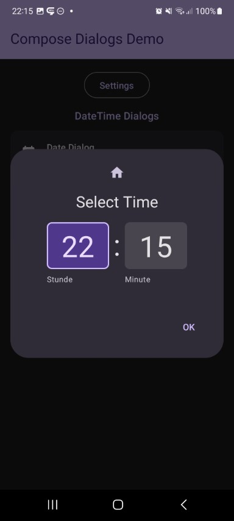

This shows a time selector dialog. 24h mode is optional.

Check out the composable and it's documentation in the code snipplet below.

Generally following can be adjusted:

* 12h/24h mode

#### Example

<!-- snippet: Demos::demo-time -->
```kt
if (state.visible) {

    // special state for time dialog
    val time = rememberDialogTime()
    // optional settings
    val setup = TimePickerDefaults.setup(
        is24Hours = is24Hours,
        hourPickType = if (picker) TimePickerInputType.Dropdown else TimePickerInputType.Input,
        minutePickType = if (picker) TimePickerInputType.Dropdown else TimePickerInputType.Input,
        minuteStep = if (picker) 5 else 1
    )

    DialogTime(
        state = state,
        time = time,
        setup = setup,
        icon = icon,
        title = { Text("Select Time") },
        style = style,
        onEvent = {
            if (it is DialogEvent.Button && it.button == DialogButtonType.Positive) {
                showInfo("Selected Time: ${time.value}")
            } else {
                showInfo("Event $it")
            }
        }
    )
}
```
<!-- endSnippet -->

#### Composable

<!-- snippet: DialogTime::constructor -->
```kt
/**
 * Shows a dialog with a time input
 *
 * &nbsp;
 *
 * **Basic Parameters:** all params not described here are derived from [Dialog], check it out for more details
 *
 * @param time the selected time
 * @param setup the [TimePickerSetup] - use [TimePickerDefaults.setup] to provide your own data
 * @param texts localized labels for the hour, minute, and AM/PM controls
 * @param uiProvider the UI implementation used to render the time controls
 */
@Composable
fun DialogTime(
    state: BaseDialogState,
    // Custom - Required
    time: MutableState<LocalTime>,
    // Custom - Optional
    setup: TimePickerSetup = TimePickerDefaults.setup(),
    // Base Dialog - Optional
    title: (@Composable () -> Unit)? = null,
    icon: (@Composable () -> Unit)? = null,
    style: ComposeDialogStyle = DialogDefaults.defaultDialogStyle(),
    buttons: DialogButtons = DialogDefaults.buttons(),
    options: DialogOptions = DialogDefaults.options(),
    onEvent: (event: DialogEvent) -> Unit = {},
    texts: TimePickerTexts = TimePickerDefaults.texts(),
    uiProvider: TimeUIProvider = Material3TimeUIProvider
)
```
<!-- endSnippet -->

#### Screenshots

|                                                   |                                                   |
|---------------------------------------------------|---------------------------------------------------|
|  |  |
